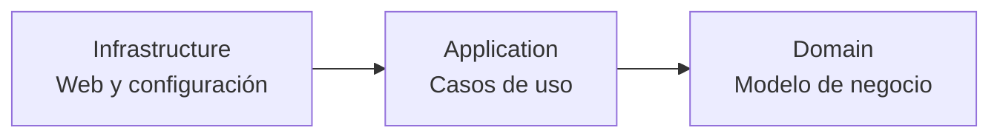

# Pokémart

**Aplicación web de gestión de Pokémon, desarrollada con Java y Spring Boot.**

Este proyecto permite crear Pokémon desde un formulario web y consultar una lista de tres Pokémon de ejemplo. También incluye rutas para probar la modificación y eliminación de Pokémon. El objetivo de la práctica es aplicar una organización modular con **Vertical Slicing** y la separación de responsabilidades de **Clean Architecture**.

## Tecnologías

Java 17 · Spring Boot · Spring MVC · Maven · Lombok · HTML

## Funcionalidades implementadas

- **Crear Pokémon:** formulario HTML mediante `POST /ordenadores`, con validación de datos.
- **Listar Pokémon:** `GET /ordenadores` muestra los Pokémon almacenados en el repositorio.
- **Modificar Pokémon:** `PUT /ordenadores/{id}` actualiza los datos de un Pokémon existente.
- **Eliminar Pokémon:** `DELETE /ordenadores/{id}` elimina un Pokémon y devuelve `204 No Content`.

> **Almacenamiento:** `OrdenadorRepositoryMockImpl` utiliza un `Map` en memoria. Los cambios se mantienen durante la ejecución, pero no se conservan al reiniciar la aplicación.

## Ejecutar el proyecto

1. Abrir el proyecto en el IDE y ejecutar la clase `StoreApplication.java` (o ejecutar `sh ./mvnw spring-boot:run` en Linux; `mvnw.cmd spring-boot:run` en Windows).
2. Abrir el formulario: <http://localhost:8080/formulario-crear-ordenador.html>.
3. Rellenar el formulario y pulsar **Crear Ordenador** para probar `POST /ordenadores`.
4. Visitar <http://localhost:8080/ordenadores> para consultar el listado mediante GET.
5. Para probar PUT y DELETE, utilizar los comandos de las guías de [modificación](documentation/ordenador/editar.md) y [eliminación](documentation/ordenador/eliminar.md).

## Arquitectura

El módulo **Pokémon** agrupa la funcionalidad relacionada con este recurso (**Vertical Slicing**) y se organiza en tres capas:

Las flechas representan las dependencias principales entre capas, no el orden exacto de ejecución de las peticiones.

## Documentación

- [Arquitectura y decisiones de diseño](documentation/arquitectura.md)
- [Creación de Pokémon — POST](documentation/ordenador/crear.md)
- [Listado de Pokémon — GET](documentation/ordenador/listar.md)
- [Modificación de Pokémon — PUT](documentation/ordenador/editar.md)
- [Eliminación de Pokémon — DELETE](documentation/ordenador/eliminar.md)
- [Manejo de excepciones de otros slices](documentation/gestion-errores.md)
