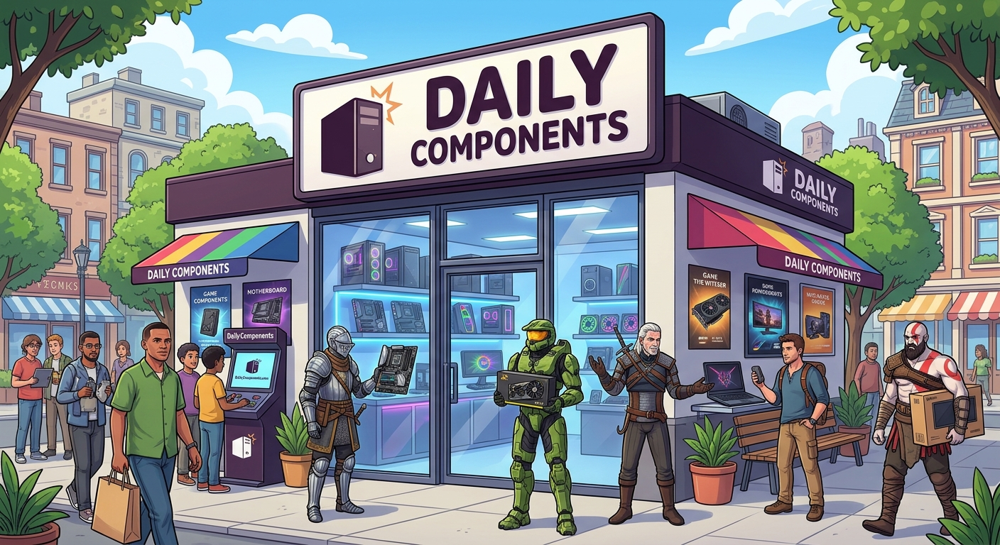
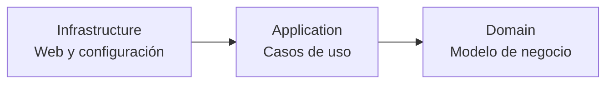

# Daily-Components

**Aplicación web de gestión de componentes, desarrollada con Java y Spring Boot.**

Este proyecto permite crear, consultar, modificar y eliminar componentes informáticos. Incluye tres componentes de ejemplo para probar la aplicación. También incluye rutas para probar la modificación y eliminación de componente. El objetivo de la práctica es aplicar una organización modular con **Vertical Slicing** y la separación de responsabilidades de **Clean Architecture**.

## Tecnologías

Java 17 · Spring Boot 4.1.1 · Spring MVC · Maven · MapStruct 1.6.3 · Lombok · HTML

## Funcionalidades implementadas

- **Crear componente:** formulario HTML mediante `POST /componentes`, con validación de datos.
- **Listar componente:** `GET /componentes` muestra los componentes almacenados en el repositorio.
- **Modificar componente:** `PUT /componentes/{id}` actualiza los datos de un componente existente.
- **Eliminar componente:** `DELETE /componentes/{id}` elimina un componente y devuelve `204 No Content`.

> **Almacenamiento:** `ComponenteRepositoryMockImpl` utiliza un `Map` en memoria. Los cambios se mantienen durante la ejecución, pero no se conservan al reiniciar la aplicación.

## Ejecutar el proyecto

1. Abrir el proyecto en el IDE y ejecutar la clase `StoreApplication.java` (o ejecutar `sh ./mvnw spring-boot:run` en Linux; `mvnw.cmd spring-boot:run` en Windows).
2. Abrir el formulario: <http://localhost:8080/formulario-crear-componente.html>.
3. Rellenar el formulario y pulsar **Crear Componente** para probar `POST /componentes`.
4. Visitar <http://localhost:8080/componentes> para consultar el listado mediante GET.
5. Para probar PUT y DELETE, utilizar los comandos de las guías de [modificación](documentation/componente/editar.md) y [eliminación](documentation/componente/eliminar.md).

## Arquitectura

El módulo **componente** agrupa la funcionalidad relacionada con este recurso (**Vertical Slicing**) y se organiza en tres capas:

Las flechas representan las dependencias principales entre capas, no el orden exacto de ejecución de las peticiones.

## Documentación
- [Información del proyecto](documentation/proyecto.md)
- [Arquitectura y decisiones de diseño](documentation/arquitectura.md)
- [Creación de componente — POST](documentation/componente/crear.md)
- [Listado de componente — GET](documentation/componente/listar.md)
- [Modificación de componente — PUT](documentation/componente/editar.md)
- [Eliminación de componente — DELETE](documentation/componente/eliminar.md)
- [Manejo de excepciones de otros slices](documentation/gestion-errores.md)
