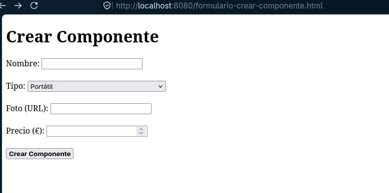
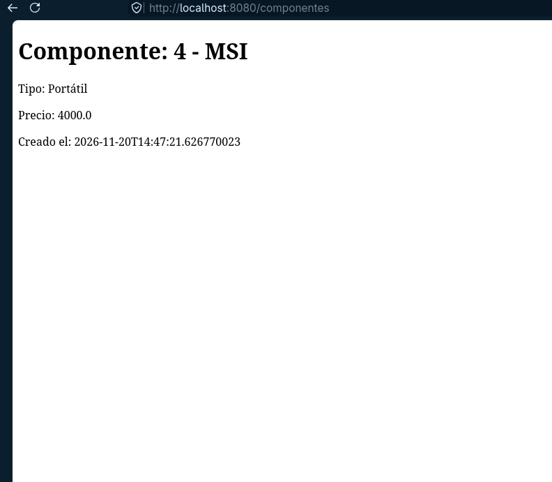

# Crear componente — POST

La aplicación permite introducir un componente mediante un formulario HTML. El navegador envía sus datos a `POST /componentes`.

## Cómo probarlo

1. Iniciar `StoreApplication.java` (la aplicación escucha en el puerto `8080`).
2. Abrir <http://localhost:8080/formulario-crear-componente.html>.
3. Rellenar los campos y pulsar **Crear Componente**.
4. El navegador recibe una página HTML con los datos del componente creado.

## Cómo funciona

El Controller valida `ComponenteRequest` con `@Valid` y el Mapper lo transforma en `CreateComponenteCommand`. Después, `CreateComponenteService` llama a `CreateComponenteUseCase`, que crea el objeto con `Componente.builder()` y lo guarda mediante `ComponenteRepository.save()`.
