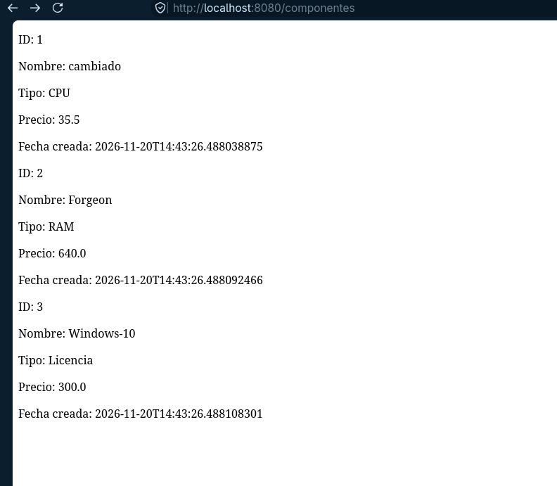

# Modificar componente — PUT

Esta práctica permite recibir el **ID** del componente desde la ruta y los **nuevos datos** desde el cuerpo de la petición.

- Ruta: `PUT /componentes/{id}`
- Controller: `@PutMapping("/{id}")`, `@PathVariable int id`, `@Valid @RequestBody ComponenteRequest`
- Flujo: `ComponenteController` → `ComponenteMapper.toCommand(id, request)` → `EditComponenteService` → `EditComponenteUseCase` → `ComponenteRepository.getById()` y `save()`. Si no existe el ID, se lanza `ComponenteNotFoundException`.

## Cómo probarlo

Iniciar `StoreApplication.java` y ejecutar en una terminal:

```bash
curl -i -X PUT http://localhost:8080/componentes/1 \
  -H "Content-Type: application/json" \
  -d '{"nombre":"cambiado","tipo":"CPU","foto":"https://ejemplo.com/CPU.png","precio":35.5}'
```

Debería de verse los resultados en <http://localhost:8080/componentes>.




