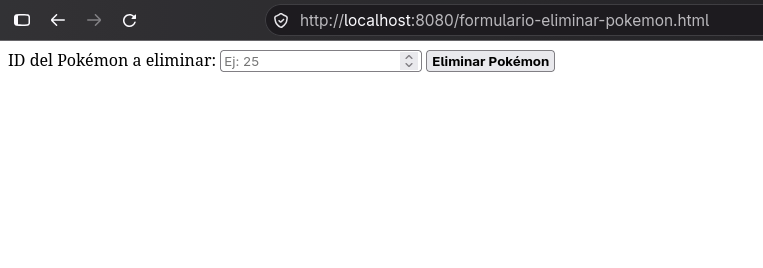

# Eliminar componente — DELETE

La petición identifica el componente que queremos eliminar mediante un parámetro de ruta: `DELETE /componentes/{id}`.

- Controller: `@DeleteMapping("/{id}")` y `@PathVariable int id`.
- Flujo: `ComponenteController` → `DeleteComponenteService` → `DeleteComponenteUseCase` → `ComponenteRepository.getById()` y `deleteById()`. Si no existe el ID, se lanza `ComponenteNotFoundException`.
- Respuesta actual: `204 No Content`.

## Cómo probarlo con curl

Iniciar `StoreApplication.java` y ejecutar:

```bash
curl -i -X DELETE http://localhost:8080/componentes/2
```

## Alternativa: formulario HTML

Iniciar `StoreApplication.java` e introducir la siguiente dirección en tu navegador:

<http://localhost:8080/formulario-eliminar-componente.html>

Deberías ver el siguiente formulario:



Si hemos eliminado el id de un componente **existente** y vamos a <http://localhost:8080/componentes>, deberíamos de ver que el componente que ha tenido ese ID ha sido eliminado.
