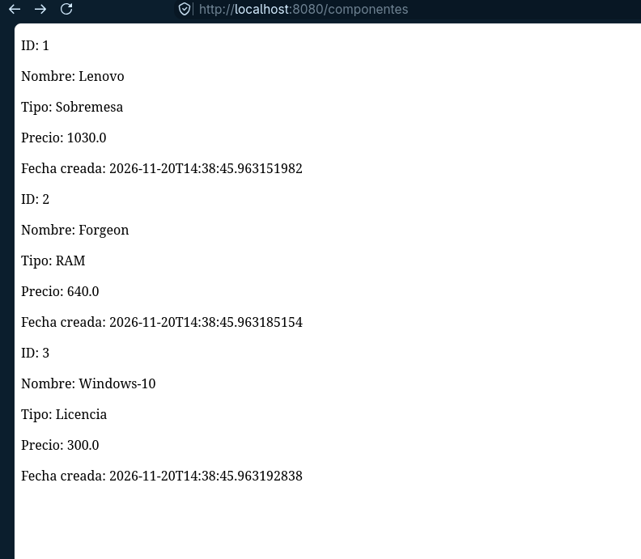

# Listar componente — GET

El listado inicial muestra tres componentes de ejemplo: Lenovo, Forgeon y Windows-10.

## Cómo probarlo

1. Iniciar `StoreApplication.java`.
2. Abrir <http://localhost:8080/componentes>.
3. El Controller devuelve una página HTML con los tres componentes.

## Cómo funciona

`ComponenteController` atiende `GET /componentes` y llama a `ListComponenteService`, que delega en `FindComponenteUseCase`. El UseCase consulta `ComponenteRepository` y devuelve la lista almacenada en `ComponenteRepositoryMockImpl`. Finalmente, el Controller genera el HTML con `StringBuilder` y un `for-each`.
