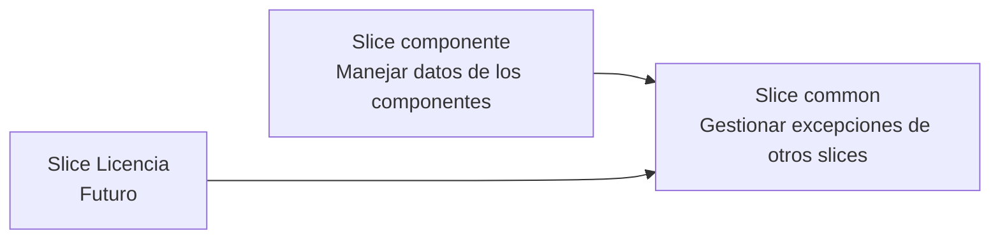

# Gestionar errores con slice common

El slice `common` permite manejar las excepciones de otros slices (como componente o, en el futuro, licencia), por ejemplo `NullPointerException`, evitando implementar la gestión de errores en el slice componente y hacer que los demás slices dependan de él.

