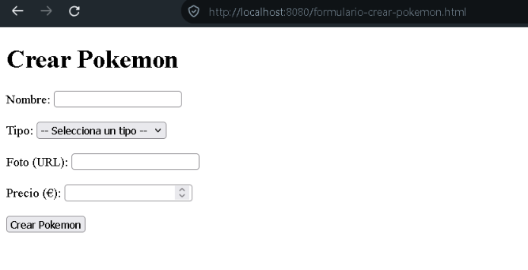
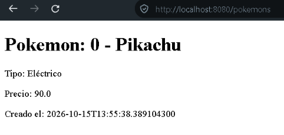

# Crear Pokémon — POST

La aplicación permite introducir un Pokémon mediante un formulario HTML. El navegador envía sus datos a `POST /ordenadores`.

## Cómo probarlo

1. Iniciar `StoreApplication.java` (la aplicación escucha en el puerto `8080`).
2. Abrir <http://localhost:8080/formulario-crear-ordenador.html>.
3. Rellenar los campos y pulsar **Crear Ordenador**.
4. El navegador recibe una página HTML con los datos del Pokémon creado.

## Cómo funciona

El Controller valida `OrdenadorRequest` con `@Valid` y el Mapper lo transforma en `CreateOrdenadorCommand`. Después, `CreateOrdenadorService` llama a `CreateOrdenadorUseCase`, que crea el objeto con `Ordenador.builder()` y lo guarda mediante `OrdenadorRepository.save()`.
